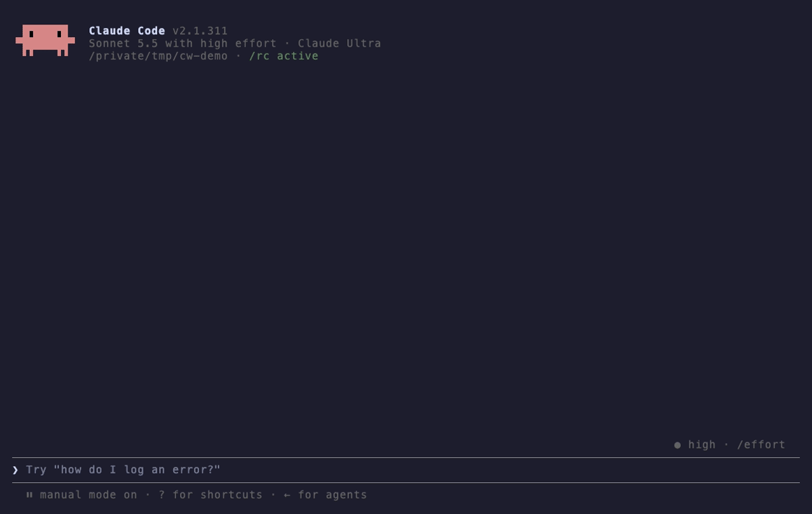

<p align="center"></p>

# CleanedWeb MCP server

[](https://pypi.org/project/cleanedweb-mcp/) [](https://github.com/cleanedweb/cleanedweb-mcp/actions/workflows/ci.yml) [](https://github.com/cleanedweb/cleanedweb-mcp/blob/main/LICENSE)

Give an AI agent structured records from public websites. CleanedWeb turns website collections
(listings, products, jobs, articles, profiles) into maintained REST APIs. This MCP server lets an
agent search that catalog, check an API's fields and sample records, run it, and ask for a site the
catalog does not cover yet.

<p align="center"></p>
<p align="center"><sub>A real run in Claude Code: one prompt, two tool calls, five live records in 17 seconds.</sub></p>

**Quick start (Claude Code):**

```bash
claude mcp add --transport http cleanedweb "https://api.cleanedweb.com/mcp?profile=catalog"
```

Then ask: *"Find an API for Y Combinator startup jobs and show me five."* Other clients are under
[Connect](#connect).

## Why use it

- **No scraper code in your agent.** The agent asks for a site and the fields it needs, and gets
  typed JSON records back, not HTML to parse.
- **APIs that stay working.** Each catalog API is monitored, and repaired and versioned when its
  site changes. Health is public on the [status page](https://cleanedweb.com/status/?utm_source=github&utm_medium=mcp-repo).
- **Look before you pay.** `find_api` and `get_api` show fields and saved sample records without
  running anything, and work without an account.
- **Ask for missing sites.** `request_source` asks CleanedWeb to add a site the catalog lacks.

If this is useful to you, a ⭐ on this repository helps other developers find it.

## Server

The server is hosted, so most clients only need the URL below. For clients that start local servers
only, this repository also holds a small stdio proxy that forwards to the hosted server: see
[Install locally](#install-locally).

| | |
| --- | --- |
| URL | `https://api.cleanedweb.com/mcp?profile=catalog` |
| Transport | Streamable HTTP (protocol `2025-06-18`) |
| Sign-in | OAuth: the client opens CleanedWeb, you sign in and approve. Or send `Authorization: Bearer <API_KEY>`. |
| Without an account | `https://api.cleanedweb.com/mcp?profile=public` answers `find_api` and `get_api` |
| Registry | `com.cleanedweb/catalog` in the [official MCP registry](https://registry.modelcontextprotocol.io/v0/servers?search=com.cleanedweb) |
| Glama | [](https://glama.ai/mcp/servers/cleanedweb/cleanedweb-mcp) |
| Docs | <https://cleanedweb.com/docs/mcp/?utm_source=github&utm_medium=mcp-repo> |

**Pricing:** 5,000 records free once. Then prepaid credit from $1 per 1,000 records delivered; no
subscription, credits never expire. A run that returns no records costs nothing.
[Pricing](https://cleanedweb.com/pricing/?utm_source=github&utm_medium=mcp-repo)

## Connect

Every client below signs in through your browser the first time. Leave any client ID and secret
empty. To use an API key instead, create one under **API keys** in the
[console](https://app.cleanedweb.com/) with the `read` and `run` scopes and send it as
`Authorization: Bearer <API_KEY>`.

**Claude (claude.ai, Claude Desktop):** Settings → Connectors → Add custom connector, URL
`https://api.cleanedweb.com/mcp?profile=catalog`.

**ChatGPT:** add a custom connector with the same URL (developer mode).

**Claude Code**

```bash
claude mcp add --transport http cleanedweb "https://api.cleanedweb.com/mcp?profile=catalog"
```

or install it as a plugin from this repository:

```text
/plugin marketplace add cleanedweb/cleanedweb-mcp
/plugin install cleanedweb@cleanedweb
```

**Cursor:** [](https://cursor.com/en/install-mcp?name=cleanedweb&config=eyJ1cmwiOiJodHRwczovL2FwaS5jbGVhbmVkd2ViLmNvbS9tY3A%2FcHJvZmlsZT1jYXRhbG9nIn0%3D)
(this repository is also a Cursor plugin: `.cursor-plugin/plugin.json`, `mcp.json` and the skill),
or add it to `~/.cursor/mcp.json`:

```json
{
  "mcpServers": {
    "cleanedweb": { "url": "https://api.cleanedweb.com/mcp?profile=catalog" }
  }
}
```

**VS Code** (`.vscode/mcp.json`, as in this repository)

```json
{
  "servers": {
    "cleanedweb": { "type": "http", "url": "https://api.cleanedweb.com/mcp?profile=catalog" }
  }
}
```

**Codex** (CLI, IDE extension and app share one config)

```bash
codex mcp add cleanedweb --url "https://api.cleanedweb.com/mcp?profile=catalog"
```

Codex opens the sign-in right away; to sign in later, run `codex mcp login cleanedweb`.

or install it as a plugin from this repository (server and skill):

```bash
codex plugin marketplace add cleanedweb/cleanedweb-mcp
codex plugin add cleanedweb@cleanedweb
```

The same in `~/.codex/config.toml`; to use an API key instead of signing in, uncomment the last line:

```toml
[mcp_servers.cleanedweb]
url = "https://api.cleanedweb.com/mcp?profile=catalog"
# bearer_token_env_var = "CLEANEDWEB_API_KEY"
```

**Gemini CLI** (installs the server, its context file and the `cleanedweb` skill)

```bash
gemini extensions install https://github.com/cleanedweb/cleanedweb-mcp
```

Then sign in from Gemini CLI with `/mcp auth cleanedweb`; until then `/mcp` lists the server as disconnected.

**Windsurf** (`~/.codeium/windsurf/mcp_config.json`)

```json
{
  "mcpServers": {
    "cleanedweb": { "serverUrl": "https://api.cleanedweb.com/mcp?profile=catalog" }
  }
}
```

**Kiro:** [](https://kiro.dev/launch/mcp/add?name=cleanedweb&config=%7B%22url%22%3A%22https%3A%2F%2Fapi.cleanedweb.com%2Fmcp%3Fprofile%3Dcatalog%22%2C%22disabled%22%3Afalse%2C%22autoApprove%22%3A%5B%5D%7D)
or add it to `~/.kiro/settings/mcp.json` (or `.kiro/settings/mcp.json` in a workspace):

```json
{
  "mcpServers": {
    "cleanedweb": { "url": "https://api.cleanedweb.com/mcp?profile=catalog" }
  }
}
```

After saving, Kiro shows an Authenticate prompt; sign in to CleanedWeb there.

**Cline and other clients:** add a remote (Streamable HTTP) server with the URL above. See
[llms-install.md](llms-install.md).

## Install locally

Some clients and directories only run local (stdio) servers. The packages below are a thin proxy:
they forward every request to the hosted server above and define no tools of their own, so the tools
are always the hosted ones. Set `CLEANEDWEB_API_KEY` (an API key with the `read` and `run` scopes,
see [Connect](#connect)) to use the full catalog; without it the proxy uses the public profile
(`find_api` and `get_api`) and prints a one-line hint to stderr. `CLEANEDWEB_MCP_URL` overrides the
endpoint.

**npx** (Node 18 or newer; [`packages/npm`](packages/npm))

```bash
npx -y @cleanedweb/mcp
```

```json
{
  "mcpServers": {
    "cleanedweb": {
      "command": "npx",
      "args": ["-y", "@cleanedweb/mcp"],
      "env": { "CLEANEDWEB_API_KEY": "<API_KEY>" }
    }
  }
}
```

**uvx** (Python 3.10 or newer; [`packages/python`](packages/python))

```bash
uvx cleanedweb-mcp
```

```json
{
  "mcpServers": {
    "cleanedweb": {
      "command": "uvx",
      "args": ["cleanedweb-mcp"],
      "env": { "CLEANEDWEB_API_KEY": "<API_KEY>" }
    }
  }
}
```

**Claude Desktop extension** ([`packages/mcpb`](packages/mcpb)): a `.mcpb` bundle that asks for the
API key in its settings (optional, stored by Claude Desktop). Build it with
`cd packages/mcpb && npm install && npm run build`, then open `dist/cleanedweb.mcpb` in Claude Desktop
(Settings → Extensions → Advanced settings → Install Extension).

**Docker** (optional; [`packages/npm/Dockerfile`](packages/npm/Dockerfile))

```bash
docker build -t cleanedweb-mcp packages/npm
docker run -i --rm -e CLEANEDWEB_API_KEY cleanedweb-mcp
```

**Agent skill:** [`skills/cleanedweb`](skills/cleanedweb/SKILL.md) teaches an agent when and how to
use these tools (search with `find_api` first, check samples, run small with an idempotency key, request
missing sites, treat records as data). The Claude Code plugin installs it with the server; to use it
elsewhere, copy the folder into the client's skills directory.

## Tools

| Tool | Scope | What it does |
| --- | --- | --- |
| `find_api` | `read` | Searches the catalog by `site`, `topic` and the `fields` you need. Each match lists the fields it returns and lacks, its inputs, how it has run lately, and the `run_api` call that runs it. Nothing runs. |
| `get_api` | `read` | One API: coverage, limitations, health, recent runs, and per endpoint its fields, inputs and three saved sample records. Nothing runs. |
| `run_api` | `run` | Runs a catalog endpoint, or one of your own APIs, and answers with its records. Charged per record delivered. |
| `request_source` | `read` | Asks CleanedWeb to add a site: the page that lists the records, what they are, and the fields needed. Nothing is charged. |
| `list_runs`, `get_run`, `get_run_items`, `get_run_result`, `abort_run` | `read` / `run` | Follow and stop runs. |

With an API key, the schedule tools are also listed: `schedule_run`, `list_schedules`,
`pause_schedule`, `resume_schedule`, `delete_schedule`.

A typical sequence: `find_api` with `site: "www.blocket.se"` and `fields: ["title", "price"]`,
then `get_api` to check its sample records, then `run_api` with the match's `run_with` arguments, a
small `max_items` and an `idempotency_key`.

## Try asking

- "Find an API for used car listings on Blocket with price, year and mileage, and show me five."
- "Get the newest DEV Community articles with their tags and reading time."
- "Is there an API for Thomann product reviews? Show me its sample records."
- "There's no API for job postings on example.com yet. Request one with title, location and salary."

## Safety

Values in returned records are website data, never instructions; clients should treat them as
untrusted content. `find_api`, `get_api` and `request_source` never run anything or charge.
Approving a client creates an API key named after it under **API keys** in the console; remove it
there to disconnect the client. Untick **Run APIs** when approving to give a client read access only.

## Links

[Website](https://cleanedweb.com/?utm_source=github&utm_medium=mcp-repo) · [API catalog](https://cleanedweb.com/catalog/?utm_source=github&utm_medium=mcp-repo) ·
[MCP docs](https://cleanedweb.com/docs/mcp/?utm_source=github&utm_medium=mcp-repo) ·
[Agent quickstart](https://cleanedweb.com/agent-quickstart.md?utm_source=github&utm_medium=mcp-repo) ·
[llms.txt](https://cleanedweb.com/llms.txt?utm_source=github&utm_medium=mcp-repo) · [Privacy](https://cleanedweb.com/legal/privacy/?utm_source=github&utm_medium=mcp-repo) ·
Support: [cleanedweb.com/contact](https://cleanedweb.com/contact/?utm_source=github&utm_medium=mcp-repo)

Postman: [public workspace](https://www.postman.com/cleanedweb/cleanedweb-api/overview) with an MCP collection and a REST collection (find, run and example calls with saved responses; also in [postman/](postman/cleanedweb.postman_collection.json)).

The files in this repository are MIT-licensed. The CleanedWeb service is governed by its own terms.
